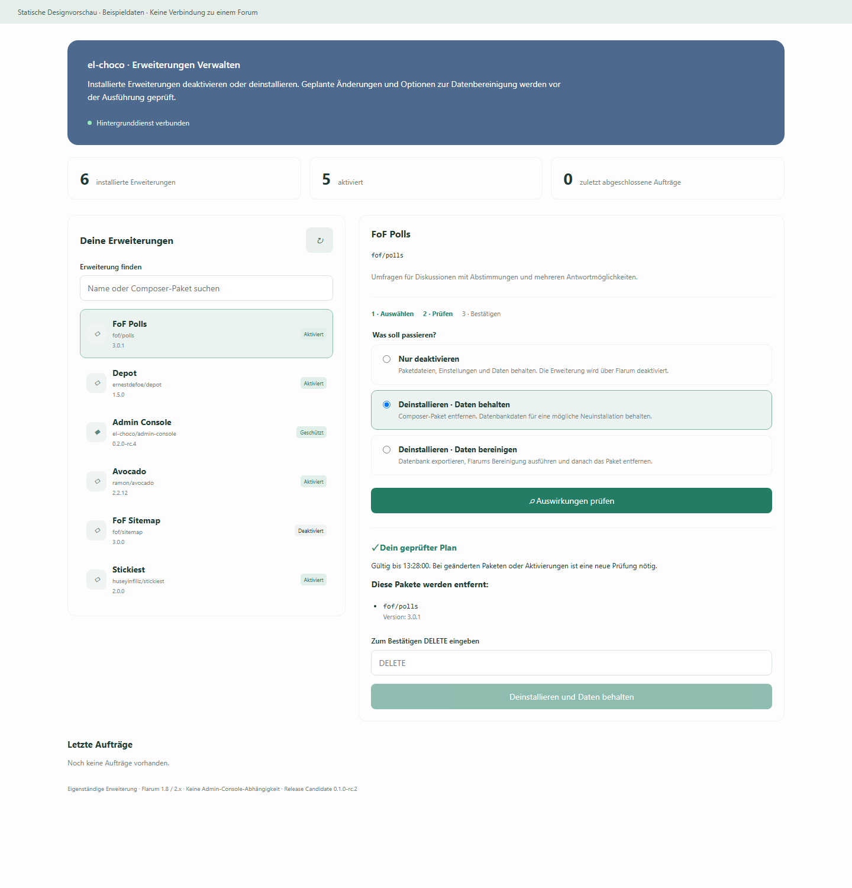

# el-choco/extension-uninstaller

Eigenständiger Deinstallierer für Flarum 1.8 und 2.x. **Die Admin Console wird nicht benötigt.**

**Stand: 0.1.0-rc.2 – Release Candidate, abschließende Live-Prüfungen stehen noch aus.**



## Drei klar getrennte Wege

| Aktion | Composer-Paket | Datenbank |
|---|---|---|
| Nur deaktivieren | Bleibt installiert | Kein Purge |
| Deinstallieren · Daten behalten | Wird entfernt | Kein Purge; Daten für eine mögliche Neuinstallation bleiben grundsätzlich erhalten |
| Deinstallieren · Daten bereinigen | Wird entfernt | Vollständiger SQL-Export, anschließend Flarums Purge |

Eine Vorschau zeigt die genaue Paketentfernung. Zum Deinstallieren wird vor der Ausführung ausdrücklich `DELETE` eingegeben;
beim reinen Deaktivieren lautet das Bestätigungswort `DISABLE`. Bei Datenbereinigung ist eine zweite
Bestätigung erforderlich. Die Standardauswahl behält Daten.

## Was diese Version bereits umsetzt

- Installierte Erweiterungen suchen, Aktivierung und Abhängigkeiten sehen.
- Composer-Plan in einem privaten Arbeitsverzeichnis vorbereiten; keine
  Live-Paketänderung während der Vorschau.
- Gleichwertige relative/absolute Pfadangaben lokaler Pakete erkennen und ihre bisherigen Lock-Metadaten erhalten.
- Keine zusätzlichen Paketinstallationen oder -aktualisierungen erlauben;
  ungenutzte Bibliotheken im Plan anzeigen, andere Erweiterungen nicht mitentfernen.
- Zeitlich begrenzte, administratorgebundene Einmalpläne und Schutz gegen doppelte Anfragen.
- Nicht-root Worker, dauerhafte Aufträge, Status und Ausgabe im Adminbereich.
- Paketsicherung vor Änderungen; bei Purge zusätzlich ein SQL-Export mit Prüfsumme.
- CrazyMax-Erweiterungsliste nur nach bestätigtem Composer-Erfolg synchronisieren.
- Cache und Flarum-CLI-Start abschließend prüfen; Web-OPcache für Autoload-Dateien invalidieren.
- Gemeinsame Ausführungssperre mit der vorhandenen el-choco Admin Console.
- Separate Frontend-Builds für Flarum 1 und 2, jeweils mit deutschen und englischen Texten.

## Grenzen bewusst kennen

Flarums Purge verwendet die Rückwärtsmigrationen und Hooks der jeweiligen
Erweiterung. Er kann Tabellen und Spalten entfernen, ist aber kein universeller
Restereiniger. Einstellungen, Berechtigungen, Uploads, externe Dateien und andere
Reste können bleiben. Die Anwendung löscht keine Tabellen oder Einstellungen
anhand vermuteter Namen. Auch das Verhalten eigener Disable-/Uninstall-Hooks
bleibt in der Verantwortung der jeweiligen Erweiterung.
Solche Hooks können auch Dateien löschen. Ein SQL-Export sichert keine Uploads;
dafür ist die vorherige vollständige Dateisicherung notwendig.

Ein SQL-Export ist eine Sicherung, kein getesteter Restore. Es gibt keinen
automatischen Datenbank-Rollback und keinen „Undo“-Knopf. Scheitert ein Schritt
nach Beginn einer Änderung, werden weitere Aufträge bis zur manuellen Prüfung
blockiert. Bei bereits unstartbarem Flarum kann auch der Flarum-Aktionsprozess
scheitern; dann ist weiterhin das Terminal notwendig.

Unterstützte Konfiguration: Linux, Standard-Composer-Verzeichnis `vendor`, MySQL/MariaDB und
Composer 2.8 oder neuer. Datenbereinigung setzt `mariadb-dump` oder `mysqldump`
**in der Worker-Umgebung** sowie eine InnoDB-Datenbank voraus. SQLite, externe
Symlink-Pakete, relative URLs in der Composer-Repository-Konfiguration, installierte Dev-Abhängigkeiten und
indirekte Paketentfernungen werden in dieser Version nicht unterstützt.

Core, der Deinstallierer selbst und die el-choco Admin Console sind vor Entfernung
über diese Oberfläche geschützt. Andere Paketwerkzeuge und manuelle
Terminalbefehle müssen während der Arbeit pausieren; die Sperre koordiniert
unsere beiden Worker, nicht beliebige fremde Prozesse.

## Loslegen

- **[Deutsche Installationsanleitung](INSTALL-DE.md)** – normale Installation und CrazyMax Docker.
- **[English installation guide](INSTALL-EN.md)**.
- [Update von RC1 auf RC2, einschließlich früherer lokaler Quellen](UPDATE-DE.md).
- [English update guide](UPDATE-EN.md).
- [Release notes RC2](docs/RELEASE-RC2-EN.md).
- [Testbericht und offene Live-Prüfungen](docs/TEST-REPORT.md).
- [Technischer Ablauf und Wiederherstellung](docs/ARCHITECTURE.md).
- [Statische Designvorschau](docs/preview.html) – Beispieldaten, keine Verbindung zum Forum.

Das Paket ist auf [Packagist](https://packagist.org/packages/el-choco/extension-uninstaller) veröffentlicht. Die RC2-Befehle gelten, sobald der Tag `v0.1.0-rc.2` auf Packagist übernommen wurde. Kein lokales Repository ist nötig. Für den ersten Praxistest eine entbehrliche Erweiterung
auf einer gesicherten Testinstallation wählen: zuerst deaktivieren, dann mit
erhaltenen Daten entfernen und wieder installieren. Die Purge-Variante erst an
einer separaten Datenbankkopie prüfen.

## Entwicklung

```bash
cd js
npm ci
npm run build
node --test ../tests/frontend.test.cjs
```

PHP-Tests mit den tatsächlichen Flarum-Abhängigkeiten:

```bash
php tests/safety.php /pfad/zum/flarum/vendor/autoload.php
php tests/security.php /pfad/zum/flarum/vendor/autoload.php
php tests/coordination.php /pfad/zum/flarum/vendor/autoload.php
php tests/backup.php /pfad/zum/flarum/vendor/autoload.php
php tests/path-metadata.php /pfad/zum/flarum/vendor/autoload.php
php tests/composer-path-preview.php /pfad/zum/flarum/vendor/autoload.php /pfad/zu/composer.phar
php tests/composer-preview.php /pfad/zum/flarum/vendor/autoload.php /pfad/zu/composer.phar
```

Der letzte Test erstellt ein eigenes Projekt mit künstlichen lokalen
Paketdefinitionen. Er deinstalliert nichts aus dem übergebenen Flarum: Dessen
Autoloader liefert lediglich die Testabhängigkeiten.

Die Entwicklungstests verwenden PHP 8.3/8.4. Die eigentlichen Erweiterungsdateien
vermeiden PHP-8-Syntax, damit Flarum 1.8 auch unter unterstützten älteren PHP-
Versionen installierbar bleibt; ein separater PHP-7.4-Lauf wurde lokal nicht ausgeführt.

MIT-Lizenz. [Quellcode und Fehlerberichte auf GitHub](https://github.com/el-choco/extension-uninstaller).
